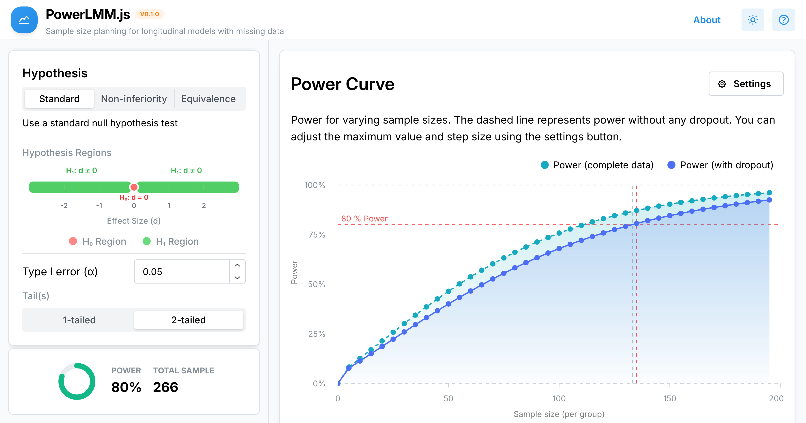

Power analysis for longitudinal LMMs is often challenging because results depend heavily on parameters such as random slopes and on the impact of missing data. I have therefore been working on a new web app (PowerLMM.js) that simplifies this by showing in real time how different values influence power and model‑implied parameters (e.g., correlations and standard deviations at each time point). The tool is designed to remove technical barriers to rigorous power analysis and to support not only standard null‑hypothesis tests but also non‑inferiority and equivalence tests. An important goal of PowerLMM.js was not to trade off accuracy for speed, and I have extensively validated the results against various R implementations of the same linear algebra. 

[Launch PowerLMM.js](https://powerlmmjs.rpsychologist.com)

### Key features

- Real‑time updates of power and model‑implied parameters
- Support for missing data/dropout mechanisms
- Random slopes and flexible longitudinal designs
- Standard null‑hypothesis tests, plus non‑inferiority and equivalence tests
- Runs in the browser as a client-side app
- Results extensively validated against R implementations of the same linear algebra

### Try PowerLMM.js
App URL: [https://powerlmmjs.rpsychologist.com](https://powerlmmjs.rpsychologist.com)

