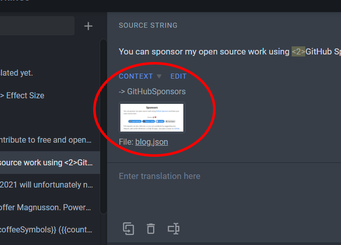

# Help to translate

Currently the [Cohen's _d_ visualization](https://rpsychologist.com/cohend) has i18n support, and any help with translating the contents is very appreciated!

The texts to translate are in [`src/lib/viz/cohend/i18n/messages/en.json`](../src/lib/viz/cohend/i18n/messages/en.json), and each language has its own file next to it (e.g. `sv.json`, served at `/sv/cohend`).
A text that hasn't been translated yet is shown in English, so a partial translation is fine.

Keep the placeholders (`{d}`, `{g0}`, …) and the tags (`<em>`, `<sub>`, `<a1>`, …) as they are; you can move them within the sentence.
`{g0}` and `{g1}` are the two group labels, e.g. "Control" and "Treatment".

## Steps

1. Join the project over at Crowding:
   - [Join as a translator](https://crwd.in/rpsychologist-cohend)
   - [Join as a proofreader](https://crowdin.com/project/rpsychologist-cohend/invite?d=7565g66576k5l5b3c3r473r4b3)
2. Tell me to add your language, if it isn't already added to the project
3. Start translating

Don't hesitate to contact me if you have any questions.

### Crowdin tips

Most strings have screenshots under "context" that highlight where on the page the text is located.



## Attribution

The translation will be attributed to you on the translated page, e.g., "translated by Your Name". I can link to your webpage if you'd like.
Credits live in [`src/lib/viz/cohend/i18n/translators.json`](../src/lib/viz/cohend/i18n/translators.json):

```json
{ "name": "Kristoffer Magnusson", "url": "https://rpsychologist.com" }
```

Let me know if you don't want to be mentioned as a translator.
